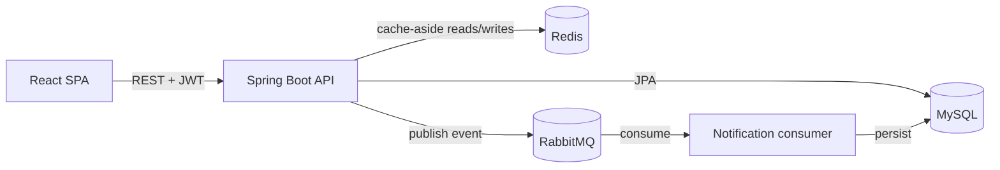

# CodeShare — Code Snippet Sharing Platform

A full-stack platform for publishing, discovering, and discussing code snippets. Built with
**React**, **Spring Boot 3** (Java 17), and **MySQL**, with **Redis**-backed JWT session
management and cache-aside caching, and **RabbitMQ**-driven asynchronous notifications.
Containerized with **Docker** and deployable to **AWS**.

## Features

- **Landing page** — signed-out visitors hitting `/` see a marketing hero (headline, CTA,
  decorative snippet-feed mockup); once logged in, `/` goes straight to the snippet grid
  ([`Hero`](frontend/src/components/Hero.jsx)).
- **Authentication** — register/login with JWT access + refresh tokens; refresh tokens are
  whitelisted and access tokens can be blacklisted on logout, both tracked in Redis
  (see [`RedisTokenService`](backend/src/main/java/com/codeplatform/security/RedisTokenService.java)).
- **Snippet publishing** — create, edit, delete code snippets with a title, description,
  language, tags, and visibility (public/private).
- **Search & pagination** — full-text-ish keyword search over title/description, filter by
  language or tag, all paginated server-side
  ([`SnippetController`](backend/src/main/java/com/codeplatform/controller/SnippetController.java)).
- **User interactions** — like, favorite/bookmark, and comment on snippets.
- **Async notifications** — likes/comments/favorites publish an event to RabbitMQ; a
  separate consumer persists the notification without blocking the triggering request
  ([`NotificationProducer`](backend/src/main/java/com/codeplatform/mq/NotificationProducer.java) /
  [`NotificationConsumer`](backend/src/main/java/com/codeplatform/mq/NotificationConsumer.java)).
- **Cache-aside reads** — snippet detail and search results are cached in Redis with a short
  TTL and evicted on writes, cutting DB load for hot snippets
  ([`SnippetService`](backend/src/main/java/com/codeplatform/service/SnippetService.java)).
- **Snippet comparison** — pick any two published snippets (from any two users) and view a
  line-by-line diff, side by side
  ([`ComparePage`](frontend/src/pages/ComparePage.jsx), [`DiffView`](frontend/src/components/DiffView.jsx)).

## Tech stack

| Layer | Technology |
|---|---|
| Frontend | React 18, React Router, Axios, Vite, PrismJS (syntax highlighting) |
| Backend | Java 17, Spring Boot 3 (Web, Security, Data JPA, Validation, AMQP, Data Redis) |
| Database | MySQL 8, versioned with Flyway |
| Cache / sessions | Redis (cache-aside + JWT token management) |
| Messaging | RabbitMQ (async notification fan-out, with a dead-letter queue) |
| Auth | JWT (access + refresh, HMAC-signed via `jjwt`) |
| Infra | Docker, Docker Compose, AWS (EC2 prototype → ECS/RDS/ElastiCache/Amazon MQ path) |

## Architecture



## Project structure

```
code_platform/
├── backend/                # Spring Boot 3 API (Java 17)
│   └── src/main/java/com/codeplatform/
│       ├── config/         # Security, Redis, RabbitMQ, CORS, JWT/cache properties
│       ├── controller/     # REST endpoints
│       ├── service/        # Business logic (snippets, comments, auth, notifications)
│       ├── security/       # JWT provider, Redis token whitelist/blacklist, auth filter
│       ├── mq/              # RabbitMQ producer/consumer + message DTO
│       ├── repository/     # Spring Data JPA repositories
│       ├── entity/ & dto/  # JPA entities and API request/response models
│       └── exception/      # Global exception handling
├── frontend/                # React SPA (Vite)
│   └── src/
│       ├── api/             # Axios client (JWT refresh interceptor) + per-resource calls
│       ├── components/      # Navbar, Hero, SnippetCard, DiffView, SnippetPicker, CodeBlock, ...
│       ├── context/         # AuthContext
│       └── pages/           # SnippetListPage (home), SnippetDetailPage, ComparePage,
│                             # PublishSnippetPage, ProfilePage, NotificationsPage, auth pages
├── docker-compose.yml        # MySQL + Redis + RabbitMQ + backend + frontend
└── deploy/aws/               # EC2 prototype deployment guide + target cloud architecture
```

## Running locally

### Option A: Docker Compose (closest to production)

```bash
cp .env.example .env   # edit JWT_SECRET / DB password if you like
docker compose up -d --build
```

- Frontend: http://localhost:3000
- Backend API: http://localhost:8080/api
- RabbitMQ management UI: http://localhost:15672 (guest/guest)

### Option B: run services individually (faster iteration)

```bash
# 1. infra only
docker compose up -d mysql redis rabbitmq

# 2. backend (http://localhost:8080/api)
cd backend
./mvnw spring-boot:run

# 3. frontend (http://localhost:5173, proxies /api to :8080)
cd frontend
npm install
npm run dev
```

## API overview

| Endpoint | Auth | Description |
|---|---|---|
| `POST /api/auth/register` \| `/login` \| `/refresh` \| `/logout` | — | Auth lifecycle |
| `GET /api/snippets?keyword=&language=&tag=&page=&size=` | public | Paginated search |
| `GET /api/snippets/{id}` | optional | Snippet detail (cached) |
| `POST /api/snippets` \| `PUT /api/snippets/{id}` \| `DELETE /api/snippets/{id}` | required | Publish/edit/delete |
| `POST /api/snippets/{id}/like` \| `/favorite` | required | Toggle like/favorite |
| `GET/POST /api/snippets/{id}/comments`, `DELETE /api/comments/{id}` | mixed | Comment thread |
| `GET /api/notifications`, `/unread-count`, `POST /read-all` | required | Async notification feed |

## Deploying to AWS

See [`deploy/aws/DEPLOY.md`](deploy/aws/DEPLOY.md) for a step-by-step EC2 + Docker
Compose prototype deployment, and
[`deploy/aws/cloud-architecture.md`](deploy/aws/cloud-architecture.md) for how it maps to
managed services (RDS, ElastiCache, Amazon MQ, ECS/Fargate, S3 + CloudFront) beyond the
prototype stage.

## Tests / CI

`.github/workflows/ci.yml` runs the backend test suite (`mvn verify`), builds the frontend
(`npm run build`), and builds both Docker images on every push/PR.
