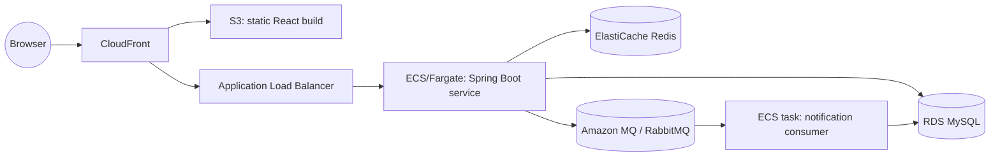

# Target architecture (post-prototype)

Once the app outgrows the single EC2 box in [DEPLOY.md](./DEPLOY.md), the same three
containers split across managed services like this:

Notes:

- The frontend becomes a static S3 bucket behind CloudFront; there's no server to
  patch and it scales for free. `/api/*` requests are routed by CloudFront (or the
  ALB) to the backend instead of Nginx doing the proxying.
- The backend's `NotificationConsumer` (`backend/src/main/java/com/codeplatform/mq/NotificationConsumer.java`)
  can run as the same ECS service or split into its own task definition if
  notification volume needs to scale independently of the request-handling API.
- Redis keeps both roles it has in the prototype: JWT refresh/blacklist tracking
  (`RedisTokenService`) and cache-aside snippet caching (`SnippetService`) — moving
  to ElastiCache is purely a connection-string change (`REDIS_HOST`/`REDIS_PORT`).
- Secrets (`JWT_SECRET`, DB credentials) move from a `.env` file to AWS Secrets
  Manager, injected into the ECS task definition as secrets rather than environment
  variables baked into the image.
